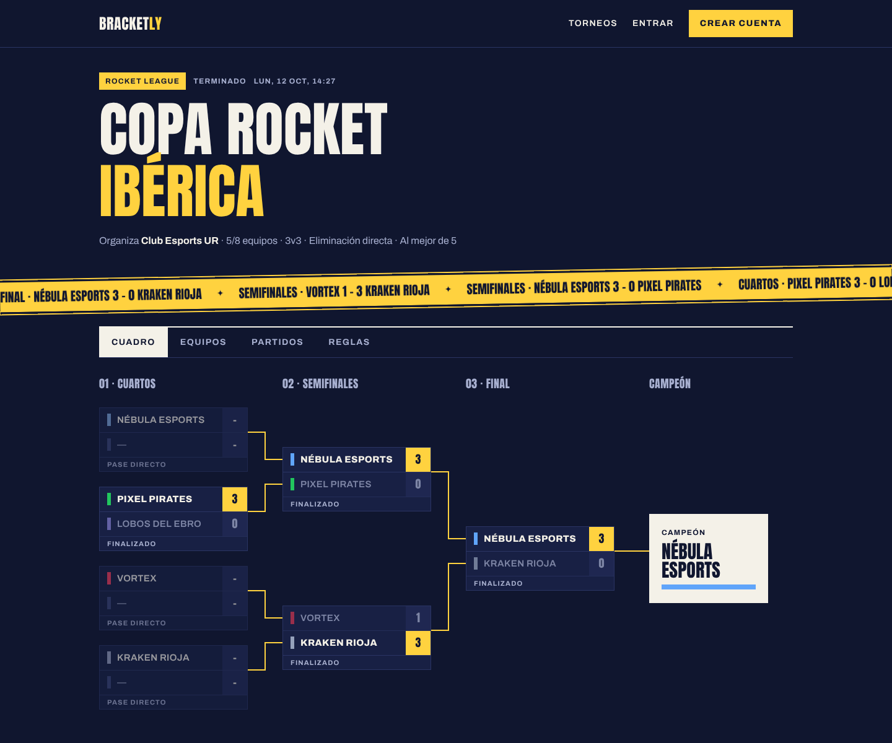
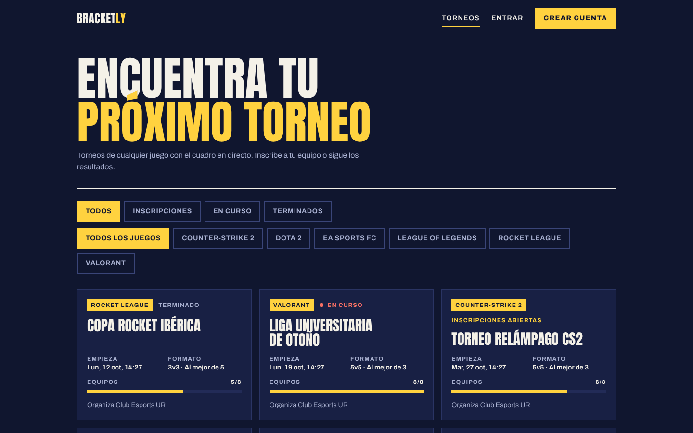
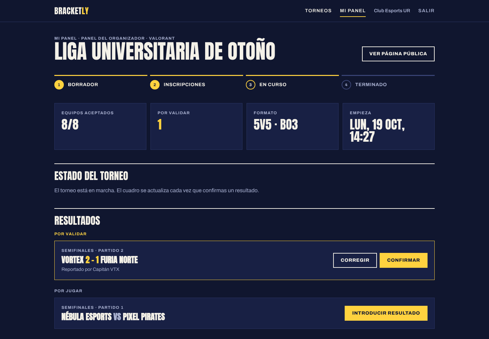
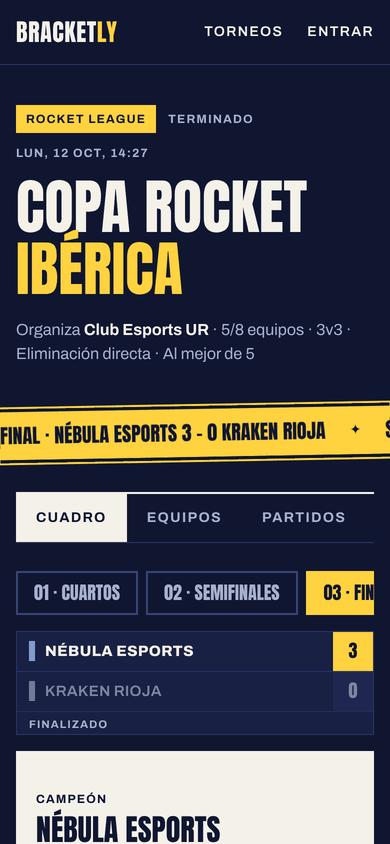
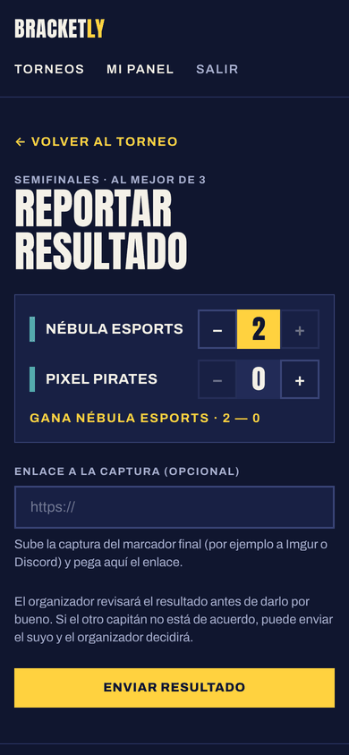
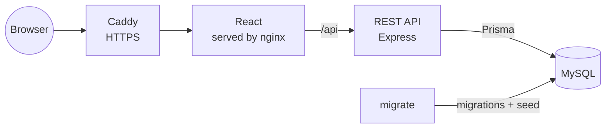

# Bracketly

[](https://github.com/MK-1379/bracketly/actions/workflows/ci.yml)

An esports tournament manager for any game. Anyone can create a tournament, teams sign up with an invite code, and the bracket updates itself with every confirmed result.

**Live demo:** https://bracketly-mk.duckdns.org (use the demo buttons on the login page, no sign-up needed)

The organizer opens registrations, accepts teams and starts the tournament. Bracketly then generates a single-elimination bracket with byes, captains report their scores from their phone, and once the organizer confirms a result the winner moves on to the next round on its own.



| Home | Organizer panel |
| --- | --- |
|  |  |

| Mobile bracket | Reporting a result |
| --- | --- |
|  |  |

## Features

- **Any game:** Valorant, League of Legends, CS2, Rocket League, Dota 2 or EA Sports FC, with team size and best-of chosen per tournament.
- **Public tournament page:** bracket drawn in SVG, teams, matches and rules, plus a results ticker. On mobile the bracket switches to one round at a time.
- **Automatic bracket:** teams are seeded into a single-elimination bracket of the next power of two, and the free slots become byes that advance on their own.
- **Teams and invites:** a captain creates a team, shares its invite code and signs it up for open tournaments.
- **Results flow:** captains report the score, the organizer confirms or corrects it, and the winner fills the next match.
- **Organizer panel:** tournament status steps, pending registrations and results waiting for validation.
- **Demo mode:** two demo accounts (organizer and captain) and sample tournaments in every state, reset every night.
- Filters on the home page are kept in the URL, so a filtered list can be shared.
- Animations respect `prefers-reduced-motion`, and the mobile score buttons are 44 px touch targets.

## Architecture



Four services in Docker Compose:

| Service | What it does | Local port |
| --- | --- | --- |
| `db` | MySQL 8.4 with a volume for the data | 3309 |
| `migrate` | Applies the Prisma migrations, the games seed and the demo data, then exits | — |
| `api` | REST API under `/api` (auth, games, tournaments, registrations, teams, matches) | 3001 |
| `web` | nginx serves the React build and proxies `/api` to the `api` container | 8081 |

`migrate`, `api` and `web` belong to the `app` profile, so `docker compose up -d` on its own only starts the database for local development. The full endpoint list is in [docs/API.md](docs/API.md).

The server is organized by feature (`auth`, `tournaments`, `teams`, `registrations`, `matches`). Each one has its routes, its Zod schemas and, where the logic grows, a service. The bracket generation lives in `server/src/bracket` as pure functions, so it is tested without a database.

## Tech stack

- **Frontend:** React 19, TypeScript, Vite, Tailwind CSS 4, React Router, TanStack Query.
- **Backend:** Node.js 24, Express 5, TypeScript, Zod, Prisma 7, node-cron.
- **Auth:** bcrypt password hashes and a JWT in an httpOnly cookie.
- **Database:** MySQL 8.4.
- **Quality:** Vitest, Supertest, Playwright, Biome and GitHub Actions.
- **Infrastructure:** Docker Compose and nginx, deployed on an Oracle Cloud ARM VM behind Caddy with Let's Encrypt.

## Getting started

Requirements: Docker with Docker Compose and Node.js 24.

1. Clone the repository and create the environment file:

   ```bash
   git clone https://github.com/MK-1379/bracketly.git
   cd bracketly
   cp .env.example .env
   ```

   Fill in the MySQL passwords and a long random `JWT_SECRET` (for example `openssl rand -hex 32`). `DATABASE_URL` uses the same user and password as `DB_USER` and `DB_PASSWORD`.

2. Build and start everything, then open http://localhost:8081:

   ```bash
   docker compose --profile app up -d --build
   ```

   The first start takes a while because MySQL initializes its data folder. `migrate` waits for it, loads the data and then `api` and `web` start.

## Development and tests

Start only the database, then run the API and the frontend with hot reload:

```bash
docker compose up -d db
docker compose exec db mysql -u root -p -e "GRANT ALL PRIVILEGES ON *.* TO 'bracketly'@'%'; FLUSH PRIVILEGES;"

cd server
npm ci
npx prisma migrate dev
npm run db:generate
npm run db:seed
npm run db:demo
npm run dev
```

```bash
cd web
npm ci
npm run dev
```

The `GRANT` is only for local development: `prisma migrate dev` needs to create a temporary shadow database and the tests use their own `bracketly_test` database. The frontend runs at http://localhost:5173 and Vite proxies `/api` to port 3001.

```bash
cd server && npm test
cd web && npm run e2e
```

- **Server (69 tests):** unit tests for the bracket algorithm and the score rules, and API tests with Supertest against `bracketly_test`, which is wiped before each test.
- **End to end (11 tests):** Playwright starts the API and the frontend against the test database and goes through the home filters, accounts, the organizer flow, reporting a result and the mobile bracket.

On every push, GitHub Actions runs Biome, the build and the tests of both parts, the Playwright suite and the Docker image builds. When all of them pass on `main`, it deploys to the server over SSH.

## Design decisions

- **Roles belong to the tournament, not to the user.** Whoever creates a tournament is its organizer (`organizerId`), so the same account can organize one tournament and play in another.
- **Each match knows where its winner goes** (`nextMatchId` and `nextSlot`). Advancing a winner is a single update, and the bracket is drawn straight from those links.
- **Results need confirmation.** A captain's report stays pending until the organizer confirms it, which avoids a single team deciding the result.
- **The session is an httpOnly cookie,** so the token can't be read from JavaScript, and the login endpoints are rate limited.
- **The demo can be broken on purpose.** Visitors can do anything with the demo accounts because a cron job rebuilds the demo data every night at 4:00 (Europe/Madrid).

## Security

See [SECURITY.md](SECURITY.md) to report a vulnerability.

## License

The source code is released under the [MIT License](LICENSE).
