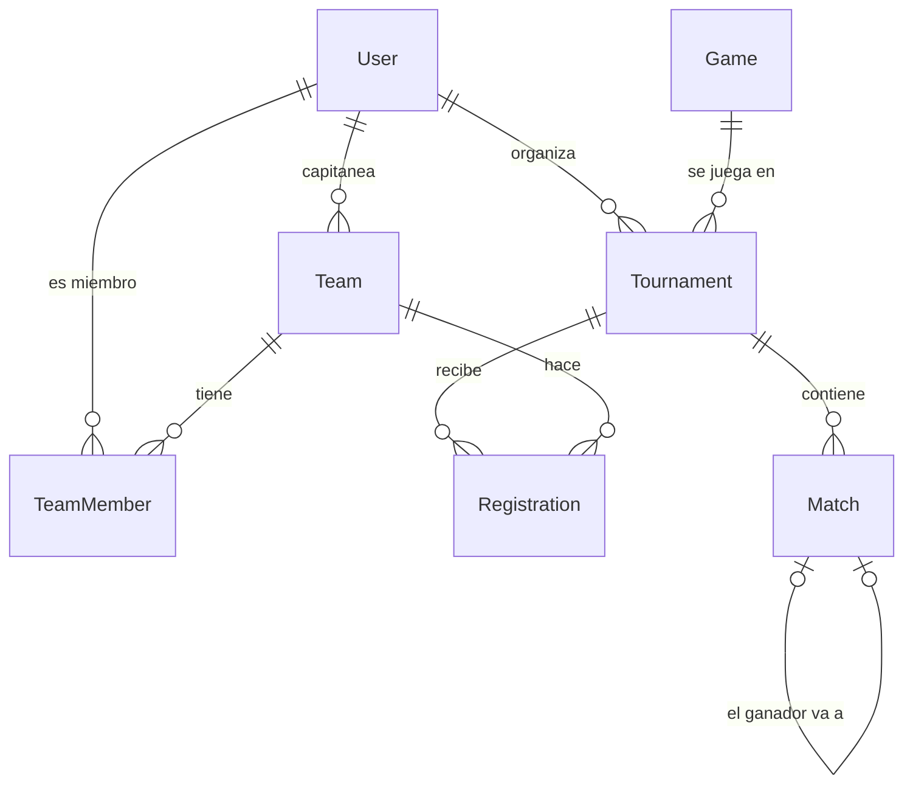

# Bracketly · Fase 0: requisitos, pantallas y modelo de datos

Torneos de esports de cualquier juego. Este documento cierra qué hace la primera versión (MVP) antes de diseñar o programar nada. Lo que no esté aquí queda para las mejoras.

## 1. Requisitos funcionales (RF)

**Cuentas**
- RF1. Un visitante puede registrarse con email, nombre visible y contraseña.
- RF2. Un usuario puede iniciar y cerrar sesión.
- RF3. En el login hay botones de cuenta demo: "Entrar como organizador" y "Entrar como capitán".

**Torneos**
- RF4. Cualquier usuario registrado puede crear un torneo y pasa a ser su organizador.
- RF5. Un torneo tiene: nombre, juego, descripción y reglas, fecha de inicio, máximo de equipos (4, 8, 16 o 32), tamaño de equipo (1 a 5 jugadores) y formato de partida (al mejor de 1, 3 o 5).
- RF6. Un torneo pasa por estos estados: borrador → inscripciones abiertas → en curso → terminado. Solo el organizador lo cambia.
- RF7. Cualquiera, sin cuenta, puede ver la lista de torneos (filtrable por juego y estado) y la página de cada torneo.

**Equipos**
- RF8. Un usuario puede crear un equipo (nombre y siglas) y pasa a ser su capitán.
- RF9. El capitán obtiene un enlace de invitación. Quien lo abre con sesión iniciada se une al equipo.
- RF10. El capitán puede expulsar jugadores y regenerar el enlace.

**Inscripciones**
- RF11. El capitán inscribe su equipo en un torneo con inscripciones abiertas, siempre que tenga el número de jugadores exigido.
- RF12. El organizador acepta o rechaza cada inscripción. No se aceptan más equipos que el máximo.

**Cuadro y partidos**
- RF13. Al pasar el torneo a "en curso", se genera el cuadro de eliminación directa con los equipos aceptados, ordenados por cabeza de serie.
- RF14. Si el número de equipos no llena el cuadro, los mejores cabezas de serie pasan la primera ronda directamente (bye).
- RF15. El capitán de cualquiera de los dos equipos reporta el resultado de su partido, con una captura opcional.
- RF16. El organizador confirma el resultado reportado o lo corrige. También puede introducirlo directamente.
- RF17. Al confirmarse un resultado, el ganador avanza solo al siguiente partido. Cuando se confirma la final, el torneo pasa a "terminado" y muestra al campeón.

## 2. Requisitos no funcionales (RNF)

- RNF1. Responsive: la parte pública debe verse bien desde 360 px de ancho.
- RNF2. Accesibilidad: navegable con teclado, contraste AA y el cuadro con alternativa en lista de partidos.
- RNF3. Seguridad: contraseñas con bcrypt, sesión en cookie httpOnly, validación de toda la entrada con Zod y permisos comprobados en el servidor, nunca solo en el frontend.
- RNF4. El algoritmo del cuadro tiene tests unitarios que cubren 2, 3, 5, 8 y 16 equipos.
- RNF5. Tema claro y oscuro.
- RNF6. Despliegue gratuito, con los datos demo restaurados cada noche.

## 3. Pantallas

| Ruta | Quién | Contenido |
|---|---|---|
| `/` | Todos | Portada: qué es Bracketly, torneos destacados (en curso y próximos) y llamada a crear uno |
| `/torneos` | Todos | Lista de torneos con filtros por juego y estado |
| `/torneos/:slug` | Todos | Cabecera del torneo y pestañas: Cuadro, Equipos, Partidos, Reglas |
| `/equipos/:id` | Todos | Equipo: jugadores, torneos jugados y resultados |
| `/login` y `/registro` | Visitante | Formularios, con los botones de cuenta demo en el login |
| `/panel` | Usuario | Inicio privado: mis torneos (como organizador), mis equipos y mis próximos partidos |
| `/panel/torneos/nuevo` y `/panel/torneos/:slug` | Organizador | Crear y editar, gestionar inscripciones, iniciar el torneo y validar resultados |
| `/panel/equipos/nuevo` y `/panel/equipos/:id` | Capitán | Crear y editar el equipo, enlace de invitación, jugadores e inscribirse en torneos |
| `/partidos/:id/reportar` | Capitán | Formulario de resultado con captura |
| `/unirse/:codigo` | Usuario | Confirmar la unión a un equipo |

Las pantallas clave para diseñar primero (fase 1) son la página del torneo con el cuadro, la portada y el panel del organizador.

## 4. Modelo de datos

| Tabla | Campos | Notas |
|---|---|---|
| `User` | id, email (único), passwordHash, displayName, createdAt | |
| `Game` | id, slug, name, logoUrl | Tabla fija rellenada por el seed (LoL, Valorant, CS2, Rocket League, EA FC...). Así el filtro por juego no depende de que la gente escriba el nombre igual |
| `Tournament` | id, slug (único), name, description, rules, gameId, organizerId, startsAt, maxTeams, teamSize, bestOf, status, winnerTeamId, createdAt | `status` es un enum |
| `Team` | id, name, tag, captainId, inviteCode (único), createdAt | Sin logo en el MVP: se muestra un escudo generado con las siglas y un color |
| `TeamMember` | teamId, userId, joinedAt | Clave primaria compuesta (teamId, userId). El capitán también aparece aquí |
| `Registration` | tournamentId, teamId, status, seed, createdAt | Clave primaria compuesta. Es la tabla intermedia del N:M entre torneos y equipos, con datos propios (estado y cabeza de serie) |
| `Match` | id, tournamentId, round, position, teamAId, teamBId, scoreA, scoreB, winnerTeamId, nextMatchId, nextSlot, status, reportedById, proofUrl, updatedAt | `round` 1 = primera ronda; `position` = orden dentro de la ronda; `nextSlot` = "A" o "B" |

**Decisiones explicadas**
- **`Registration` como tabla propia:** un equipo juega muchos torneos y un torneo tiene muchos equipos. Esa relación N:M necesita una tabla intermedia, y aquí además guarda el estado de la inscripción y la cabeza de serie.
- **`nextMatchId` + `nextSlot`:** cada partido sabe a qué partido va su ganador y en qué hueco (A o B). Así avanzar al ganador es una sola actualización, y el cuadro se dibuja agrupando por `round` y ordenando por `position`.
- **Estados del partido:** `pendiente` (faltan equipos), `listo` (están los dos), `reportado` (un capitán envió resultado), `confirmado`. Un bye se crea ya `confirmado`, con un solo equipo y ese equipo como ganador.
- **Permisos:** no hay un campo "rol" en `User`. El rol depende del contexto: eres organizador de un torneo si `Tournament.organizerId` es tu id, y capitán si `Team.captainId` lo es. Es más flexible, porque una misma persona puede organizar un torneo y jugar en otro.

## 5. Reglas del cuadro (para la fase 3)

1. Tamaño del cuadro = la potencia de 2 igual o superior al número de equipos (5 equipos → cuadro de 8).
2. Byes = tamaño del cuadro − número de equipos. Se los llevan los mejores cabezas de serie.
3. Emparejamiento estándar por semillas en la primera ronda: 1 contra 8, 4 contra 5, 2 contra 7, 3 contra 6. Así el 1 y el 2 solo pueden cruzarse en la final.
4. Número de rondas = log2(tamaño del cuadro).